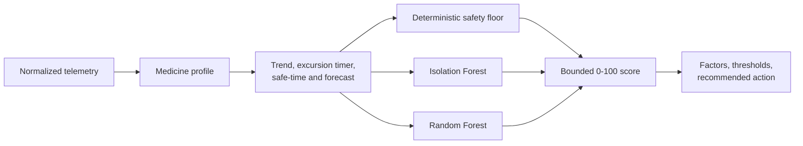

# AI Methodology

The risk engine is hybrid and explainable. Layer 1 applies product, battery, motor, route and custody rules. Layer 2 uses Isolation Forest to detect combinations outside nominal telemetry. Layer 3 uses Random Forest regression for a 0–100 operational priority score. The 16 inputs include SOC, SOH, battery and motor temperature, current, speed, container temperature and humidity, shock, deviation, delay, remaining distance, temperature trend, excursion duration, remaining safe time and forecast temperature.



The bundled model trains on 3,500 reproducible synthetic rows, split into 2,800 training and 700 holdout rows. Its error measures fit to synthetic engineering targets and are not proof of drug spoilage, vehicle failure probability or regulatory suitability.

For real labelled data, provide CSV columns matching `/api/ai/model-validation`, including `risk_target` from 0–100, then run:

```powershell
python -m app.ai.training labelled_telemetry.csv --output data/models/validated-risk-model.joblib
```

The trainer rejects missing/invalid data, requires at least 100 complete rows with at least 20 normal and 20 high/critical cases, performs a stratified holdout, and reports MAE, R² and high-risk recall. The server loads the bundle only when its feature schema matches exactly. A representative, independently labelled dataset was not supplied, so real-world retraining and validation remain pending data collection.

The local assistant maps supported questions to safe structured queries. It can summarize historical statistics and return constrained report-download/navigation actions. It never executes generated SQL or arbitrary code.

The voice agent adds a local language interface without replacing the deterministic safety engine. Faster Whisper transcribes the operator and detects Hindi, English or Marathi. The backend constructs a bounded evidence object containing the selected vehicle, BMS, container, route, ETA, active incidents, risk explanation and a deterministic reachability calculation. Qwen 2.5 3B receives only that evidence and a restrictive system instruction for Hindi/English; it cannot issue SQL or execute code. Marathi uses an audited localized safety template because the compact model's free-form Marathi translation was not reliable enough for operational readings. Temperature and distance guarantees are forbidden. Piper converts Hindi and English answers to speech, with an installed browser voice used for Marathi. Qwen failure falls back to a deterministic telemetry statement, so the operational page remains useful without the generative model.
