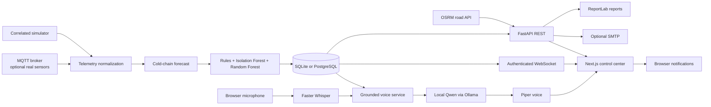

# System Architecture

ThermaTrace is a Next.js/FastAPI monorepo. FastAPI owns simulation, validated sensor ingestion, risk inference, persistence, reports, routing refresh, notifications and authenticated WebSocket fan-out. SQLAlchemy selects SQLite or PostgreSQL from `DATABASE_URL`; Alembic owns schema upgrades.

The local demo runs one Uvicorn worker because the simulator loop and WebSocket ticket registry are process-local. A scaled deployment should move simulation authority, connection tickets and message fan-out to shared services. OSRM routes are persisted, so the existing map continues to work if public routing is unavailable. SMTP and MQTT stay disabled until environment variables are supplied.

Roles are enforced on the server: VIEWER can inspect data and reports, OPERATOR can also acknowledge alerts, and ADMIN can manage scenarios, settings, users, profiles, routes and MQTT devices.

The voice path is local. Browser recordings are capped at 8 MB, written to a temporary file for transcription, then deleted. The agent receives a bounded telemetry evidence object rather than database credentials or generated SQL. A low-latency Qwen model produces a concise spoken response; deterministic evidence remains the fallback when Ollama is unavailable. Transcripts and closing notes are persisted, while raw audio is not.
