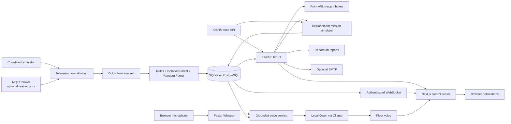

# System Architecture

ThermaTrace is a Next.js/FastAPI monorepo. FastAPI owns simulation, validated sensor ingestion, risk inference, persistence, reports, routing refresh, notifications and authenticated WebSocket fan-out. SQLAlchemy selects SQLite or PostgreSQL from `DATABASE_URL`; Alembic owns schema upgrades.

The local demo runs one Uvicorn worker because the simulator loop and WebSocket ticket registry are process-local. A scaled deployment should move simulation authority, connection tickets and message fan-out to shared services. OSRM routes are persisted, so the existing map continues to work if public routing is unavailable. SMTP and MQTT stay disabled until environment variables are supplied.

Roles are enforced on the server: VIEWER can inspect data and reports, OPERATOR can also acknowledge alerts, and ADMIN can manage scenarios, settings, users, profiles, routes and MQTT devices.

The voice path offers fast browser speech recognition and private local Whisper. Browser recognition may use a browser-provider network service; local recordings are capped at 8 MB, temporarily written for transcription, and then deleted. Deterministic operational intents use bounded telemetry evidence and can write auditable in-app Point A/B messages or start one simulated replacement mission. General questions can use local Qwen with a short timeout and deterministic fallback. Answer text returns before speech synthesis. Transcripts and closing notes are persisted, while raw audio is not.

Rescue vehicles are virtual mission records, not physical fleet vehicles. The simulator advances their position on stored road geometry every tick; public OSRM can refine pickup and onward routes in the background. The UI marks these journeys as accelerated demo travel and shows both separate point inboxes. No external party receives the messages.
