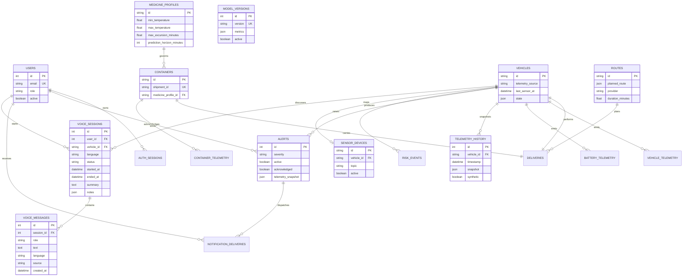

# Database Schema

Alembic migrations through `0003_rescue_dispatch` support populated SQLite databases and fresh SQLite/PostgreSQL schemas. JSON snapshots preserve full telemetry while indexed normalized tables support audit and targeted queries.

`synthetic=false` distinguishes accepted MQTT records. Model artifacts stay on disk; `model_versions` stores provenance and validation metrics when an approved model is registered. Use PostgreSQL backups and secret management before production deployment.

Voice records store the human/assistant transcript and structured closing note. They intentionally contain no raw microphone payload or generated audio file.
