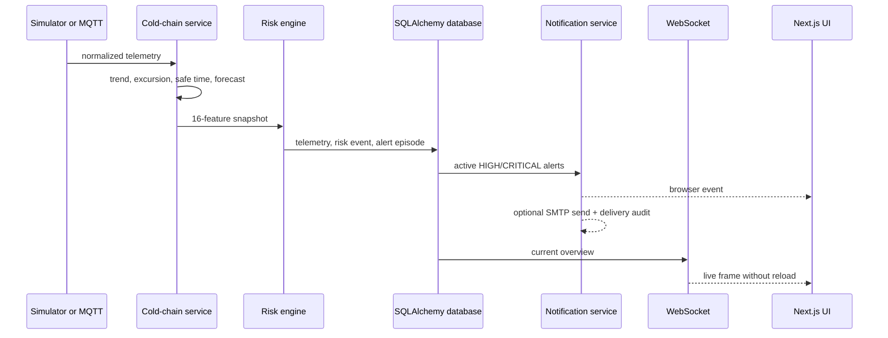

# Data Flow



MQTT packets must match a registered active `device_id` and its vehicle. Only allowlisted fields are merged into the last complete baseline snapshot. The resulting record is re-evaluated through the same cold-chain and AI path and persisted with `synthetic=false`.

Route refresh sends seed waypoints to OSRM using GeoJSON output, converts longitude/latitude order, stores the road geometry, distance and duration, and preserves prior route data on failure.

```mermaid
sequenceDiagram
    participant User as Operator microphone
    participant Web as AI Voice Center
    participant STT as Browser speech or Faster Whisper
    participant Agent as Grounded intent service
    participant DB as Live telemetry database
    participant Dispatch as Point A/B inboxes
    participant Rescue as Rescue simulator
    participant TTS as Browser/Piper/Marathi neural voice
    User->>Web: Speak Hindi, English or Marathi
    Web->>STT: Speech turn (browser by default)
    STT->>Agent: Transcript + detected language
    Agent->>DB: Read selected vehicle, route, alerts, history
    DB-->>Agent: Timestamped bounded evidence
    Agent->>Dispatch: Persist authorized Point A/B commands
    Agent->>Rescue: Assign virtual replacement mission
    Agent-->>Web: Immediate answer text + transcript
    Web->>TTS: Fetch/play speech separately
    TTS-->>Web: Spoken answer
    Web-->>User: Spoken answer + visible transcript
    Agent->>DB: Transcript; closing summary and notes
    Rescue->>DB: Position and mission state each simulator tick
    DB-->>Web: WebSocket map and chat updates
```

The fast path handles breakdown/status/dispatch intents from structured live data without waiting for text-to-speech or a general model. Unrecognized questions use the grounded assistant with a bounded local-model timeout and deterministic fallback. Browser speech recognition is fast but may use the browser provider's speech service; local Whisper is an explicit private option with slower first load. Point A/B messages are internal application records, not external SMS/email.
