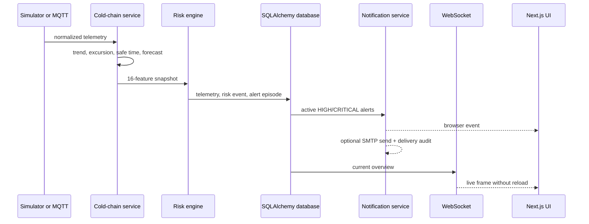

# Data Flow



MQTT packets must match a registered active `device_id` and its vehicle. Only allowlisted fields are merged into the last complete baseline snapshot. The resulting record is re-evaluated through the same cold-chain and AI path and persisted with `synthetic=false`.

Route refresh sends seed waypoints to OSRM using GeoJSON output, converts longitude/latitude order, stores the road geometry, distance and duration, and preserves prior route data on failure.

```mermaid
sequenceDiagram
    participant User as Operator microphone
    participant Web as AI Voice Center
    participant STT as Faster Whisper
    participant Agent as Grounded voice service
    participant DB as Live telemetry database
    participant Qwen as Local Qwen / Ollama
    participant TTS as Piper
    User->>Web: Speak Hindi, English or Marathi
    Web->>STT: Temporary audio turn
    STT->>Agent: Transcript + detected language
    Agent->>DB: Read selected vehicle, route, alerts, history
    DB-->>Agent: Timestamped bounded evidence
    Agent->>Qwen: Evidence + operator question
    Qwen-->>Agent: Concise grounded answer
    Agent->>TTS: Response text
    TTS-->>Web: Compressed local speech response
    Web-->>User: Spoken answer + visible transcript
    Agent->>DB: Transcript; closing summary and notes
```
